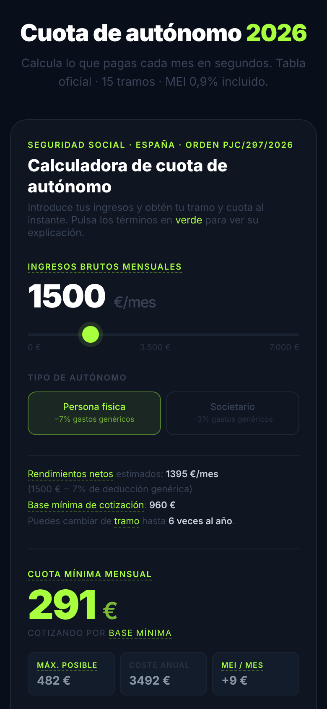

# Calculadora de cuota de autónomo 2026

Herramienta web que calcula al instante cuánto paga un autónomo en España a la Seguridad Social en 2026, con la tabla oficial de **15 tramos** por rendimientos netos y el MEI (0,9 %) incluido.

**Pruébala:** https://robertvalentinmol.github.io/calculadora-cuota-autonomos/

  
  

## Qué hace

- Introduces tus ingresos brutos mensuales con un deslizador y eliges si eres autónomo persona física o societario.
- Estima los rendimientos netos aplicando la deducción por gastos genéricos (7 % o 3 %).
- Muestra tu tramo, la base mínima de cotización, la cuota mínima y máxima, el coste anual y el MEI mensual.
- Gráfico con tu posición dentro de los 15 tramos (tabla reducida y general).
- Glosario integrado: cada término en verde se explica al pulsarlo, pensado para quien no sabe de fiscalidad.
- Diseño adaptado a móvil y escritorio.

Los datos salen de la Orden PJC/297/2026 (BOE-A-2026-7296). Es una herramienta orientativa y no sustituye el asesoramiento de un gestor.

## Stack

HTML, CSS y JavaScript sin frameworks ni dependencias, en un único archivo. Se publica tal cual con GitHub Pages.

## Ejecutarla en local

Abre `index.html` en el navegador.

---

Hecho por [Robert Valentin Moldovanu](https://www.linkedin.com/in/robert-moldovanu) · Estudiante de Ingeniería Informática (Universitat Jaume I)
